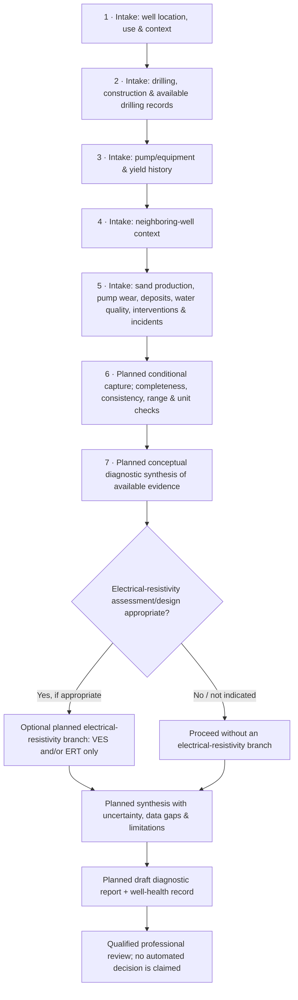

# Chahkav — Groundwater Well Diagnostic Decision-Support

> **Portfolio case study · Independent project**  
> **Project status: Workflow and interface requirements design**  
> **Implementation status: Not built.** No executable Chahkav code or scripts have been written in this conversation.

Chahkav is a proposed decision-support workflow for organizing evidence about groundwater-well condition and framing a preliminary diagnostic review. This portfolio documents requirements, conditional intake concepts, and a high-level workflow—not a working application, validated diagnostic method, or operational service.
*Figure 1. Planned workflow concept. Every stage shown is a design concept; it does not indicate implementation, deployment, validation, or completed pilot work.*


## Project at a glance

- **Domain:** Groundwater well condition and diagnostic decision support
- **Role:** Independent project
- **Status:** Workflow and interface requirements design
- **Work represented here:** Intake form requirements, conditional form behavior, and a high-level process concept
- **Not represented:** A functioning platform, executable scripts, field results, validated recommendations, or a completed pilot

## Designed workflow

The proposed pipeline organizes reported and available evidence before a qualified professional review. Data capture is conditional: follow-up fields are intended to appear only when relevant to the selected request or a preceding response. Input checks are design concepts for completeness and internal consistency, plausible ranges, and units; they are not implemented validators.

1. **Intake — well location, use, and context.** Record the well/site location and map position, land-use and water-use context, request objective, and relevant site notes.
2. **Intake — drilling and construction.** Capture available construction details, dimensions, drilling history/logs, and related records.
3. **Intake — pump, equipment, and yield history.** Organize pump/equipment information, operating context, reported discharge/yield and water-level history, and dates/units where available.
4. **Intake — neighboring wells.** Capture available nearby-well context to help distinguish a site-specific concern from a broader reported trend.
5. **Intake — symptoms and evidence.** Group sand production, pump wear/failures, deposits, water-quality observations or available test results, interventions/maintenance, incidents, and supporting drilling records. These are intake categories, not diagnostic conclusions.
6. **Conditional capture and input checks (planned).** Request relevant follow-up details based on the case and prior answers; flag missing, inconsistent, out-of-range, or unit-ambiguous entries for review. No specific thresholds, formulas, or scoring rules are published here.
7. **Conceptual diagnostic synthesis (planned).** Bring the submitted well history, symptoms, construction/equipment details, neighboring-well context, and available records together as evidence for a preliminary assessment. The synthesis logic is not implemented or validated.
8. **Optional electrical-resistivity branch (planned, where appropriate).** Consider whether an electrical-resistivity assessment/design is relevant. The geophysical scope is limited to **VES and/or ERT**; this is an optional planning branch, not a claim that a survey has been performed.
9. **Draft outputs and professional review (planned).** Prepare a draft diagnostic report and a well-health record, explicitly stating uncertainty, data gaps, assumptions, and limitations, for review by a qualified professional. These are proposed outputs, not generated deliverables from a deployed system.

## Editable workflow (Mermaid)



## Scope, safeguards, and limitations

- **Design only:** The workflow, form structure, and conditional logic are requirements/design concepts. The platform has not been implemented, deployed, validated, or piloted based on the confirmed conversation details.
- **No executable code:** No Chahkav scripts or application code were written in this chat. Unrelated QGIS scripts, if any exist elsewhere, are not part of this project and are not attributed to Chahkav.
- **Electrical-resistivity methods only:** Any optional geophysical planning is restricted to **VES and/or ERT**, where appropriate. No other geophysical methods are in scope here.
- **Not an engineering determination:** A draft record or report would require professional interpretation and review. The concept does not establish well condition, groundwater availability, rehabilitation feasibility, or drilling suitability.
- **No proprietary internals disclosed:** This repository intentionally omits real well data, contact details, exact weights, thresholds, scoring rules, formulas, and proprietary algorithms.
- **Uncertainty matters:** Missing, self-reported, dated, or unit-ambiguous information may constrain interpretation; proposed outputs should communicate those limitations rather than imply certainty.

## Suggested repository layout

```text
chahkav-github-portfolio/
├── README.md
└── assets/
    └── chahkav-diagnostic-pipeline.png
```

This is a documentation-only portfolio snapshot. Additional materials should be added only when their status, provenance, and permission to publish are clear.

## Intellectual property

**Chahkav workflow and interface concepts are presented for portfolio documentation. All rights reserved unless separately stated in writing.** This repository does not grant a broad reuse, redistribution, or commercial-use license. Do not treat the diagram or requirements as permission to implement or reproduce proprietary methods. No confidential or operational well data is included.
# chahkav-groundwater-well-diagnostics
Portfolio overview of a groundwater well diagnostic decision-support project.
